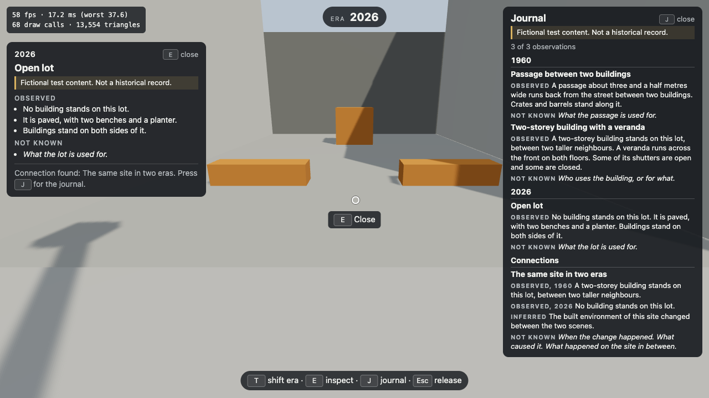
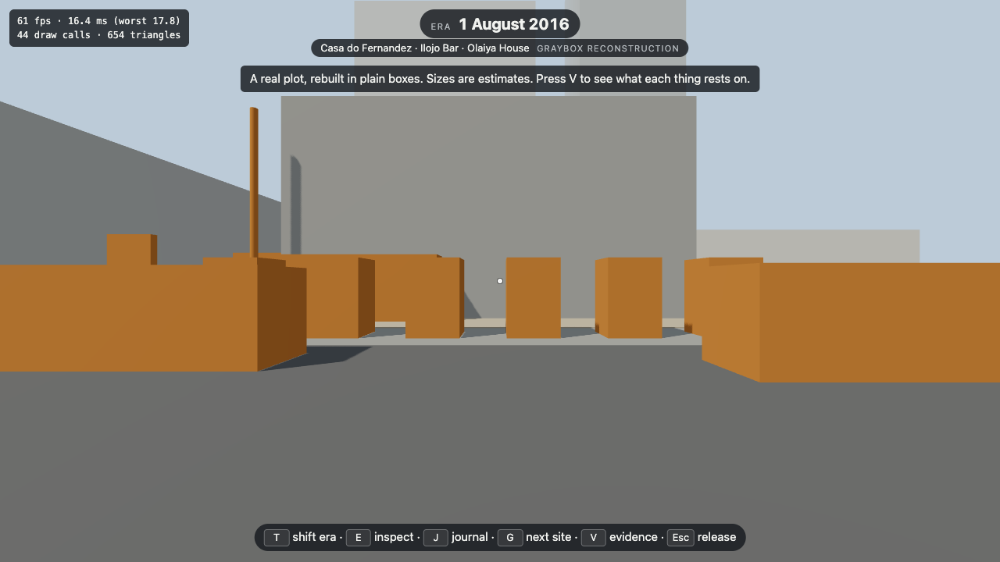
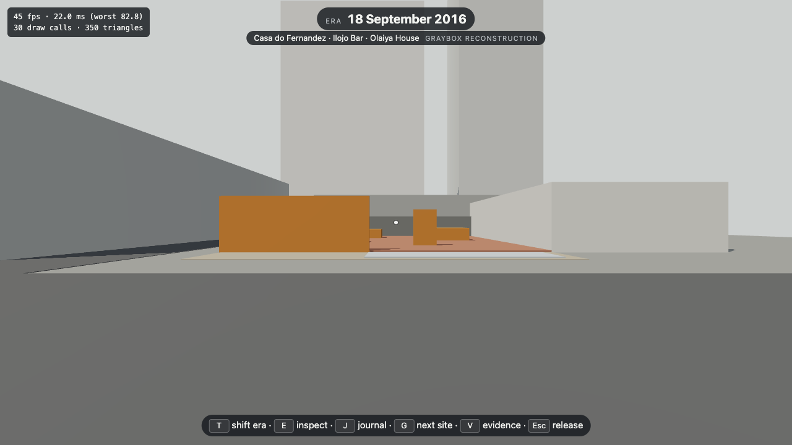
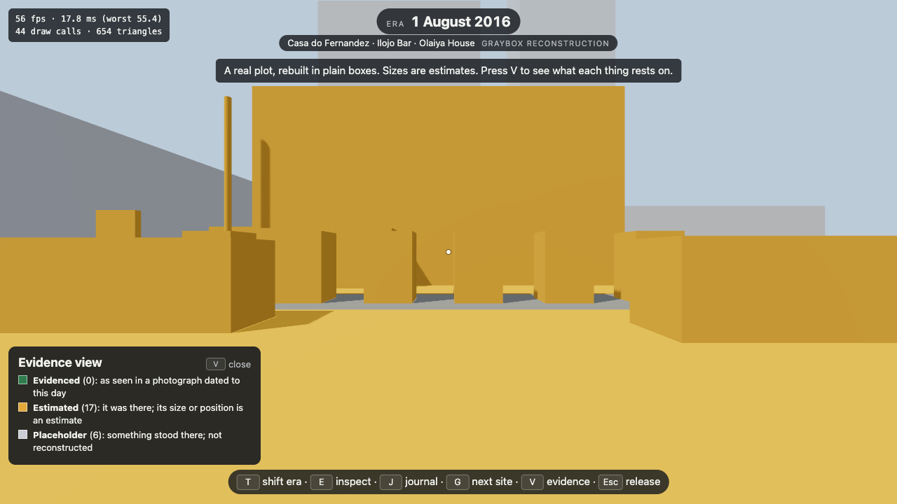
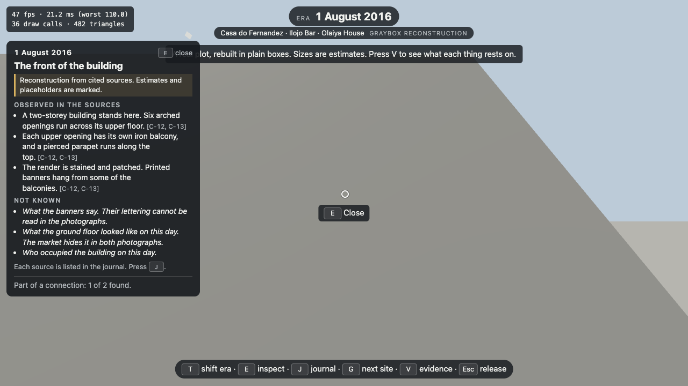

# Time Machine

A browser-based 3D historical exploration game. You are an invisible observer: you walk reconstructed places, shift between eras, and investigate what you find, without changing history.

This repository holds a vertical slice. Six milestones are done:

- **Milestone 01**: a graybox street you can explore in first person.
- **Milestone 02**: time shift. Press T to switch the street between two layouts, labelled 1960 and 2026, without losing your position or view.
- **Milestone 03**: the first authored asset. One building, modelled in Blender and exported as GLB, stands on the street in the 1960 layout. Everything else is still graybox.
- **Milestone 04**: observation and discovery. Look at one of three points of interest, press E to inspect it, and it is recorded in a journal. Observing the same lot in both eras reveals one connection.
- **Milestone 05**: research, with no change to the game. It chose the first real Lagos site to reconstruct and set the rules for doing so. See [docs/research/milestone-05/](docs/research/milestone-05/).

- **Milestone 06**: the first real site, in plain boxes. A plot on Tinubu Square, Lagos, on two days in 2016, with seven things to inspect and every statement tied to a source. See "The first real site" below.

There are no characters.

> **The street the game opens on is fictional.** Both layouts are graybox test environments invented to exercise the game's systems. They are not historically verified reconstructions of Lagos or of any other place, and "1960" and "2026" are placeholder labels for two test datasets. The one modelled building is a fictional architectural study, not a reconstruction of a real building or period. Every observation and connection in the game is invented test content, and says so on screen. The street makes no historical claim. The second site and the research notes in `docs/research/` do, and each claim cites its source.

## Run it

Requires Node 20.19+ or 22.12+ (Vite's requirement).

```
npm install
npm run dev
```

Open the address it prints, then click the page to take control.

| Input | Action |
|---|---|
| W A S D or arrow keys | Move |
| Mouse | Look around |
| Shift | Run |
| T | Shift to the other era |
| E | Inspect what you are looking at; press again to close |
| J | Open or close the journal |
| G | Go to the next site |
| V | At the real site: colour everything by what it rests on |
| PgUp, PgDn | Scroll the journal, if the window is too short to show it all |
| Esc | Release the mouse |
| P | Show or hide the performance readout |

A keyboard and mouse are required. Touch screens and gamepads are not supported yet.

## Shifting era

The game starts in the 2026 layout. T switches to the other layout; the label at the top of the screen and the sky colour show which one you are in.

- **If the spot you stand on is clear in the other era**, you arrive on exactly the same spot, looking the same way.
- **If something stands there in the other era**, you are backed out of it by up to 2 m, but only out of the thing you would overlap and never across another wall.
- **If there is no such way out**, the shift is refused, nothing changes, and a message says so.

The modelled building is on the east side, a few steps ahead of where you start. It exists only in the 1960 layout: shift there and it appears; shift back and its lot is open ground.

Other places to try it: the alley on the west side (open in 1960, built over in 2026), the lot between the two northern buildings on the east side (a yard in 1960, a building in 2026), and the open lot with benches on the east side (open in 2026, a building in 1960).

## Observing

Three places can be inspected: a building and a passage in the 1960 layout, and an open lot in 2026. A small pale marker shows where each is once you are close.

To inspect something you have to be **near it, looking at it, with nothing in the way**. When all three hold, a prompt appears under the crosshair and E opens a panel. The two locations (the lot and the passage) need you to look at their ground or the things standing on it; a level gaze across them does not count.

What you inspect is recorded in the journal, once, with the era it was seen in. Inspect the building in 1960 and the open lot on the same site in 2026, in either order, and the journal gains a connection between them.



Everything is sorted into three kinds, and they are kept apart in the data as well as on screen:

| Kind | Meaning |
|---|---|
| Observed | What a person standing there could see. No names, uses, dates or reasons. |
| Inferred | What follows from comparing observations. Only connections hold these. |
| Not known | What cannot be told from looking, stated plainly. |

The one connection is deliberately cautious. It quotes what was observed in each era, infers only that the site's built environment changed, and lists when, why and what happened in between as not known. It names no event.

Neither panel pauses the game or releases the mouse: you can walk, look and shift era with both open. A panel closes when you press E again, walk well away, shift era, or release the mouse.

## Commands

| Command | What it does |
|---|---|
| `npm run dev` | Start the game locally with hot reload |
| `npm run build` | Type-check and produce a production build in `dist/` |
| `npm run typecheck` | Strict TypeScript check of the game, config and tests |
| `npm run lint` | Lint with Oxlint |
| `npm test` | Unit tests (Vitest) for movement, collision, the layouts and shifting |
| `npm run test:e2e` | Browser tests (Playwright): load the game and play it |
| `npm run asset:export` | Export the Blender source file to the GLB the game loads. Needs Blender |
| `npm run asset:generate` | Rebuild the Blender source file from its script. Needs Blender; see the warning in [assets/README.md](assets/README.md) |

The browser tests start their own dev server on port 5199 and drive the Google Chrome installed on your machine. To use Playwright's own browser instead, run `npx playwright install chromium` and delete the `channel: 'chrome'` line in `playwright.config.ts`. They save screenshots of the street in both eras under `test-results/`.

## How the code is organised

```
src/
  world/    Places, as plain data: sites, the two street layouts, collision boxes
  content/  The source registry and the rules that keep sourced content honest
  player/   Movement and collision (pure functions) and the first-person controller
  era/      Which eras exist, and what shifting between them does to the player
  discovery/  What the player is looking at, the journal, and the keys for both
  render/   React Three Fiber components that draw a world
  ui/       The HUD
  state/    One Zustand store for slow-changing game state
assets/     Blender source files, the scripts that build and export them, previews
e2e/        Browser tests
docs/       Architecture notes, and research for the first real site
```

Exported models live in `src/render/models/`. How a model is made, exported, limited and measured is in [assets/README.md](assets/README.md). Blender is needed only to change a model, not to run, build or test the game.

The rule that shapes it: the world is data, simulation is pure functions, and React Three Fiber only draws. See [docs/ARCHITECTURE.md](docs/ARCHITECTURE.md) for the reasoning, how a shift stays consistent, what entity ids mean across eras, and the main technical risks.

## The performance readout

The panel in the top-left corner shows frames per second, average and worst frame time over the last half second, and the draw calls and triangles the renderer handled in the last frame. Draw calls include the shadow pass, so each shadow-casting object counts twice.

## The first real site

Press G to leave the fictional street for a real plot: the corner of Tinubu Square, Lagos, where the building known as Casa do Fernandez, Ilojo Bar and Olaiya House stood. G again returns to the street.

It is shown on two days, and T moves between them:

| Day | What is there | Dated by |
|---|---|---|
| 1 August 2016 | The building, as a plain mass, with the market and minibuses in front | Two photographs with that camera date |
| 18 September 2016 | The cleared plot: rubble, a part-removed fence and a signboard | Ten photographs published that day |





**It is a graybox, not a model of the building.** Every shape is a box. The front is 18.6 m wide, from a deed sketch of 1914; the heights and depths are estimates from photographs. The building was measured in 2012 and those drawings were not used. What surrounds the plot is not reconstructed at all.

**Press V to see what each thing rests on.** Everything is coloured as one of three kinds, and a key on screen names them:

| Kind | Meaning |
|---|---|
| Evidenced | As seen in a photograph dated to that day |
| Estimated | It was there; its size or position is an estimate, and the data says what was assumed |
| Placeholder | Something stood there; it is not reconstructed |



Nothing is marked as evidenced yet. That is deliberate: in a box world every size is an estimate, and the first thing that could honestly be called evidenced is a front modelled from the photographs, which does not exist yet.

### What can be found there

Seven things can be inspected, four on the first day and three on the second, and two connections link the days. It works as on the street, with three differences.

- **Every statement shows what it rests on**, as short references in brackets such as `[C-12, C-13]`. The journal lists each source found so far: what it is, its date and how that date is known, who holds it, and the credit line.
- **"Observed" means seen in a photograph taken on that very day**, not seen in the boxes on screen, which show almost none of it. The heading reads "Observed in the sources" to say so.
- **There is a fourth kind of statement, "Reported"**: what a named study or account states, when that source has been read but what it rests on has not been checked. It is kept apart from what is observed.



| Kind | Meaning at the real site |
|---|---|
| Observed in the sources | Visible in a cited photograph dated to the day shown |
| Inferred | Follows from comparing cited sources. Only connections hold these |
| Reported | A named source states it. Not checked beyond that |
| Not known | What the sources do not settle, stated plainly |

The connection between the two days infers only that the plot's built environment changed. It reports the date two sources give for the demolition, and lists who was responsible as not known.

What is left out on purpose: people, the demolition itself, who was responsible and why, any lettering that could not be read, and every archival photograph. The photographs inform the boxes; none is shown or stored here. The reasoning is in [docs/research/milestone-05/reconstruction-boundaries.md](docs/research/milestone-05/reconstruction-boundaries.md).

## Known gaps

The real site:

- **Most of what is observed is not drawn.** The statements describe arches, balconies and a parapet; the screen shows a box. That gap closes only with a modelled front.
- **Sources are cited, not shown.** No photograph or map appears in the game.
- **The assumption behind each estimate is in the data, not on screen.** The evidence view shows the kind, not the sentence.
- **The evidence view relies on three colours.** They differ in lightness and are named on screen, but a box cannot be asked which kind it is.
- **The sun is in the same place as on the street.** The site's grid is turned from north and the lighting does not follow.
- **The edges are invisible.** Where the reconstruction stops, the player stops, and nothing is drawn to say why.


Time shift:

- **The change is an instant cut.** There is no transition and no preloading. At graybox scale the swap costs nothing measurable, so this does not yet show what shifting will cost with real assets.
- **Two eras only**, switched in a fixed order.
- **You can arrive somewhere enclosed.** The arrival is always free of solids, but it is not checked for a way out. Shift back to leave.
- **A shift can be refused close to open ground.** Backing out only goes through the thing you would overlap, so being a little inside new geometry with that side blocked is refused even if free space is near.
- **The crossing check is sampled.** The path of a backed-out arrival is tested at intervals of a quarter of the player's radius, which leaves about 1 cm of tolerance at its edges. The arrival point itself is checked exactly.

Observation and discovery:

- **On the street, three points of interest and one connection.** All invented.
- **The journal is not saved.** It is empty again after a reload.
- **Sight and targets are boxes, not what is drawn.** The building's open veranda counts as solid, and round props as square. At grazing angles what you see and what the game allows can differ slightly.
- **Locations need a downward look**, as described above. This may need tuning.
- **The connection is written by hand.** The game does not work out that two observations are of the same place.
- **The wording check is a tripwire.** A test rejects words that assert an event, cause, date or use, but it cannot judge a sentence.
- **The journal covers the right third of the view** while open.
- **Screen-reader support is limited** to announcing the inspection panel.

Authored models:

- **One model, in one era.** The rest of the street is graybox.
- **A model does not change collision.** A lot is still one box, so the building's veranda cannot be walked onto.
- **The first appearance of the model drops one or two frames** on the development machine. Later shifts do not. Figures are in [assets/README.md](assets/README.md).
- **If the model file fails to load**, the lot shows its graybox box and the game carries on. Nothing tells the player.
- **Fine shadows are lost.** Thin parts such as balusters barely cast, because one shadow map covers the whole street.

Movement and world:

- **Flat world only.** There is no gravity, jumping, stairs or slopes; the camera stays 1.7 m above the ground. Sidewalks are drawn 12 cm high but you do not step up onto them.
- **Box collision only.** Every solid is an axis-aligned box, including round props such as barrels and the well, so their corners block you slightly outside the visible curve. Rotated buildings are not possible yet.
- **Desktop only.** No touch or gamepad controls.
- **No settings.** Mouse sensitivity and movement speed are constants in `src/player/movement.ts`.
- **A key held through a pause** resumes only when the keyboard repeats it or you press it again.

Presentation and tooling:

- **Placeholder visuals.** Untextured boxes and cylinders apart from the one model, one fixed sun, a flat sky colour, no audio.
- **The sun is fixed in the south-west**, so fronts on the west side of the street are always in shade.
- **Shadow edges** look slightly stepped up close: one 2048-pixel shadow map covers the whole street.
- **A console warning**, `THREE.Clock: This module has been deprecated`, appears on load. It comes from inside React Three Fiber and is harmless.
- **The production build warns about a large chunk.** That is three.js; code splitting is not set up yet.
- **Only Chrome is tested.**

Not started, by design: real historical content with sources, AI characters, missions, saving, and any backend.
